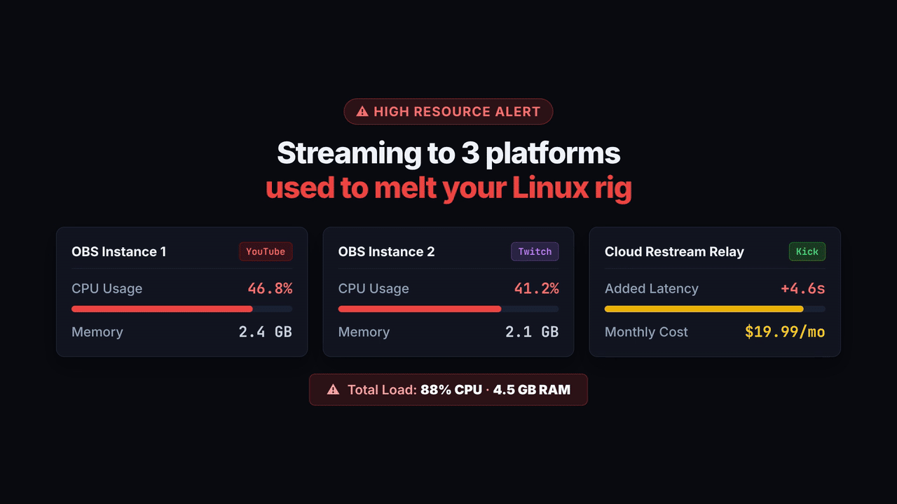
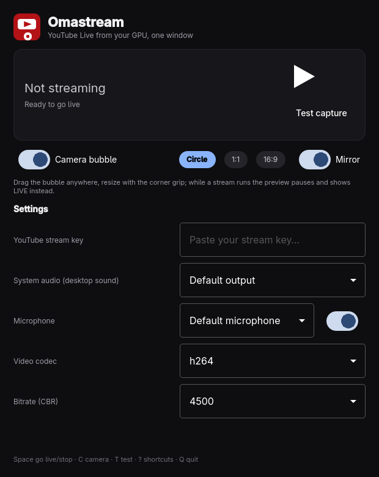

# Omastream

Multi-platform live streaming studio for Arch Linux & Omarchy — stream to **YouTube Live**, **Twitch**, and **Kick** simultaneously with zero-lag GPU encoding (`gpu-screen-recorder` → VA-API/NVENC), zero-copy multi-streaming relay (`ffmpeg` tee muxer without re-encoding), a live floating camera bubble overlay, and full compositor independence across Wayland environments (Hyprland, Sway, River, etc.).

<p align="center">
  
</p>

The app is the main surface: press **Space** to go live, press it again to stop. Select any combination of platforms (**YouTube**, **Twitch**, **Kick**) with independent toggle switches and credential cards. Everything it does it does through `omastream-cli`, the engine — quick settings (`config set`) require nothing more. No Electron, no web view: a native Qt Quick app that follows your Omarchy theme accent, needs about 10 MB of RAM, and leaves the CPU heavy lifting to your GPU.

<p align="center">
  
</p>

---

## Features

- **Parallel Multi-Platform Streaming**: Stream to YouTube, Twitch, and Kick simultaneously without extra encoder load. Zero-copy stream duplication routes the GPU-encoded stream through a local FIFO to `ffmpeg -f tee` with fault-tolerant stream isolation (`[f=flv:onfail=ignore]`). Direct single output is preserved when only one platform is active.
- **Independent Platform Controls**: Toggle individual platforms on or off with quick chip selectors in the main window and dedicated credential cards in Settings. Configure custom ingest URLs for Kick or Twitch when needed.
- **Generalized Wayland Support**: Native compositor independence. Seamlessly functions across Hyprland, Sway, River, and other wlroots/Wayland environments without crashing on missing IPC or undefined toplevels.
- **Live Camera Studio Overlay**: Floating webcam self-view composited onto your desktop display. Instant framing preview on launch, interactive shapes (Circle, 1:1 Square, 16:9 Wide), dynamic corner rounding slider, selfie mirror, and magnetic corner snapping.
- **Hardware-Accelerated Capture**: Direct GPU capture via `gpu-screen-recorder` with automatic CPU fallback when GPU encoding is unsupported.
- **Audio Routing & Text Sharpness**: Independent desktop system audio and microphone routing. Built-in screen text sharpness filters for crisp text rendering on code and terminals.
- **Live Privacy Filter & Stream Mask**: Instantly conceal sensitive information, credentials, and API keys during live broadcasts without interrupting your stream. Three developer-focused filter presets: **Frosted Blur** (dark frosted acrylic veil over code/secrets with click-through so you can paste and configure safely), **Privacy Shield** (stream paused / be right back studio curtain), and **Blackout** (pure black screen). Controllable instantly from the app with live status pills (`MASKED (FROSTED BLUR)`, `MASKED (STREAM PAUSED)`, `MASKED (BLACKOUT)`), top bar LIVE badge popup, shortcut (`P`), or CLI—with zero distracting desktop notifications.
- **Visual Key Management & Feedback**: Dedicated credential cards with instant `Saved ✓` visual confirmation buttons, active banner feedback, and quick dashboard links for YouTube, Twitch, and Kick.
- **Webcam Overlay HUD & Persistent Geometry**: Floating webcam overlay with instant on-glass HUD controls (1:1 Square, 16:9 Widescreen, Circle, Mirror Flip, Screen Corners, Close). Position, custom dimensions, and corner curvature persist reliably without resetting when toggling privacy masks.
- **Security & Privacy First**: All stream keys are kept private on your local filesystem (`chmod 600`), masked in logs and CLI outputs, and never committed or tracked. Zero telemetry.

---

## Install

### One-Line Install (Recommended)

Run this single command in your terminal to build and install Omastream and its Omarchy shell plugin:

```sh
curl -fsSL https://raw.githubusercontent.com/dhirajaryaa/omastream/main/install.sh | bash
```

Everything installs cleanly into `~/.local` (no root / sudo needed).

---

### Prerequisites (Arch Linux / Omarchy)

Make sure the required packages are installed:

```sh
sudo pacman -S --needed base-devel qt6-base qt6-declarative qt6-multimedia qt6-wayland gpu-screen-recorder jq
```

> **Note for Intel iGPU (Pre-Haswell / Ivy Bridge):**
> If you have older Intel graphics, install the legacy VA-API driver:
> `sudo pacman -S --needed libva-intel-driver libva-utils`
> (Or simply toggle **Auto CPU fallback** in Omastream settings if GPU encoding is unsupported).

---

### Manual Clone & Install (Optional)

If you prefer cloning the repository manually:

```sh
git clone https://github.com/dhirajaryaa/omastream.git
cd omastream
./install.sh
```

`install.sh` builds the native Qt app and sets up everything in your user profile:

| Component | Destination | Description |
| --- | --- | --- |
| **Omastream App** | `~/.local/bin/omastream` | Sleek, native Qt Quick window |
| **Omastream CLI** | `~/.local/bin/omastream-cli` | Core streaming & overlay engine |
| **Desktop Launcher** | `~/.local/share/applications/omastream.desktop` | App launcher entry (`Super + Space` → **Omastream**) |
| **App Icons** | `~/.local/share/icons/hicolor/` | Scalable vector and raster icons |
| **Omarchy Plugin** | `~/.config/omarchy/plugins/dhirajarya.omastream/` | Interactive camera bubble overlay & LIVE top bar badge |

Once finished, launch **Omastream** directly from your application launcher (**Super + Space**) or terminal:

```sh
omastream
```

---

### Arch Package Route (Optional)

If you prefer installing as a system package via `makepkg`:

```sh
cd omastream/pkgbuild
makepkg -si
```

---

## Go live in 60 seconds

1. **Open Omastream** from the launcher (`Super + Space` → **Omastream**).
   - The camera preview overlay launches **automatically** so you can preview framing and position your webcam immediately.
2. **Select your platforms & paste your stream keys.**
   - Click the chip selector buttons (**YouTube**, **Twitch**, **Kick**) in the main window to enable or disable platforms at any time.
   - Open Settings (**⚙** icon) to enter your credentials:
     - **YouTube Live**: Paste your YouTube stream key (click **Studio ↗** to open YouTube Studio).
     - **Twitch**: Paste your stream key `live_...` (click **Dashboard ↗** to open Twitch Creator Dashboard).
     - **Kick**: Paste your stream key `sk_...` (click **Dashboard ↗** to open Kick Dashboard). Custom RTMP/RTMPS server URLs can also be configured.
   - All credentials are stored privately in `~/.config/omastream/config.env` (`chmod 600`, never committed, never logged).
   - Prefer terminal? `omastream-cli config set YOUTUBE_KEY '<key>'`, `omastream-cli config set TWITCH_KEY '<key>'`, `omastream-cli config set KICK_KEY '<key>'`.
3. **Configure your stream**:
   - Choose your **Stream resolution limit** (Native/Auto, 1080p, 720p, 1440p, 4K, or custom `WxH`).
   - Pick **System audio** (desktop sound), **Microphone**, **Video codec** (`h264`/`hevc`), and **Bitrate**.
4. **Test run (optional)**:
   - Click **Test Stream (8s recording)** to record a short local test file (`test.flv`) to verify audio levels and video before going live.
5. **Press Space** (or click the big central button). You are live on all enabled platforms simultaneously with zero-copy stream splitting and hardware-accelerated GPU capture!
6. **Press Space again** (or click the button) to stop. The stream ends gracefully across all destinations (RTMP cleanly closed, all frames intact).

---

## Live Camera Studio & Bubble Overlay

The floating camera bubble is always interactive and visible both during preview and live streaming:

- **Instant Framing on Launch**: When you open Omastream, the webcam bubble appears immediately on screen so you can set up framing before broadcasting. It automatically closes and releases the camera when you exit the app (unless actively live streaming), and never auto-starts on PC/OS boot.
- **Zero-Flicker Hover HUD**: Hover over the webcam bubble to reveal on-glass controls with smooth transitions—no blinking, re-render flashing, or video blanking.
- **Interactive Shape Selector**: Switch instantly between **Circle**, **1:1 Square** (true pixel square width and height), and **16:9 Wide**.
- **Dynamic Corner Rounding Slider**: For 1:1 and 16:9 modes, adjust corners on-the-fly from sharp (`0px`), to squircle, to fully rounded capsules, with instant `0` and `Max` preset buttons.
- **Natural Webcam Preview**: Webcam video feed is displayed cleanly and naturally without artificial color shifts or HUD filters.
- **Stream Lifecycle Auto-Off**: When live streaming completes or when the app is closed, the webcam overlay automatically turns off and releases without leaving a dangling overlay on your desktop.
- **Selfie Mirror**: One-click toggle (`CAM_FLIP`) to mirror your front camera for a natural view.
- **Corner Snap Presets**:
  - `↖` **Top-Left**
  - `↗` **Top-Right**
  - `↙` **Bottom-Left**
  - `↘` **Bottom-Right**
- **Free Drag & Resize**: Drag the bubble anywhere across your displays with magnetic edge snapping. Grab the bottom-right handle to resize smoothly. Coordinates, shape, and corner radius persist across sessions.

---

## Top Bar Controls & Live Sync

The top bar remains completely normal during desktop use. While streaming:

- A red **LIVE** (or amber **MASKED**) badge appears on the top bar showing live stream elapsed time and privacy mask status.
- **Left-click** opens a quick control popup:
  - **Stop Stream / Stop Recording**: Stops the broadcast immediately.
  - **Hide / Show Webcam**: Toggles the camera bubble overlay.
  - **Privacy Filter Toggle**: Instantly toggles the privacy mask on/off without interrupting the stream.
  - **Privacy Mode Selectors**: Quick switch between **Blur**, **Shield**, and **Blackout**.
- **Middle-click** directly toggles the camera bubble.
- **Right-click** opens YouTube Studio.
- **Real-Time Synchronization**: Stopping or toggling the stream from the app, top bar popup, or `omastream-cli stop` synchronizes instantly across all surfaces.

---

## Settings Reference

| Setting | What it does |
| --- | --- |
| **YouTube Live** | Toggle enable/disable and store YouTube stream key (`YOUTUBE_KEY` or `STREAM_KEY`). Ingest: `rtmp://a.rtmp.youtube.com/live2/<key>`. |
| **Twitch** | Toggle enable/disable and store Twitch stream key (`TWITCH_KEY`). Ingest: `rtmp://live.twitch.tv/app/<key>`. |
| **Kick** | Toggle enable/disable, store Kick stream key (`KICK_KEY`), and custom ingest server (`KICK_URL`). |
| **Stream resolution limit** | `Native / Auto` (original display), `1080p` (1920x1080), `720p` (1280x720), `1440p` (2560x1440), `4K` (3840x2160), or **Custom resolution** (`WxH` like `1600x900` or `1920x1200`). |
| **System audio** | Desktop sound: `Default output` follows system speakers, plus every separate output device PipeWire/PulseAudio reports. |
| **Microphone** | `Default microphone` follows system input; or pick any audio source. Toggle off removes the mic track completely. |
| **Video codec** | `h264` (recommended for standard RTMP ingest) or `hevc`. |
| **Bitrate (CBR)** | 3000 / 4500 / 6000 / 8000 / 9000 kbps (4500 ≈ recommended 1080p30). |
| **Screen text sharpness** | Enhance font and UI text clarity when streaming from low-resolution monitors (e.g. 720p/900p): `Normal / Off`, `Crisp` (full contrast range 0-255 & edge tuning), `High Sharpness` (clean text for code & terminals), or `Ultra Sharp` (maximum font clarity & deblocking). |
| **Auto CPU fallback** | Automatically falls back to CPU encoding if the GPU encoder fails or is unsupported. |
| **Mirror camera** | Flips the camera horizontally. |
| **Webcam Overlay** | Show / hide the floating self-view bubble on screen. |

---

## Keyboard Shortcuts

| Key | Action |
| --- | --- |
| `Space` | Go live to active platforms / stop stream |
| `C` | Show or hide the webcam bubble |
| `P` | Toggle privacy filter overlay (blur / shield / blackout) |
| `Escape` | Close settings overlay |
| `Q` | Quit — prompts if a stream is running |

---

## `omastream-cli` — The Engine

Everything the window does is fully scriptable via the CLI:

| Command | What it does |
| --- | --- |
| `omastream-cli` | Status summary |
| `omastream-cli start [--cam on\|off] [--res WxH] [--file PATH] [--cpu-fallback]` | Go live to enabled platforms or record to a file |
| `omastream-cli stop` | Graceful stop (SIGINT closes RTMP cleanly; protected against self-kill) |
| `omastream-cli toggle` | Stop ↔ start |
| `omastream-cli status [--json\|--check]` | Machine-readable status query used by top bar and scripts |
| `omastream-cli test [--secs N]` | Short local-file pipeline test, no key required |
| `omastream-cli cam on\|off\|toggle` | Show / hide the camera bubble |
| `omastream-cli cam shape <circle\|1:1\|16:9>` | Change camera bubble shape |
| `omastream-cli cam cycle-shape` | Cycle through bubble shapes |
| `omastream-cli cam radius <0..1\|0..100>` | Adjust corner rounding (0 = sharp square, 1.0 = round/capsule) |
| `omastream-cli cam corner <tl\|tr\|bl\|br>` | Snap camera bubble to a screen corner |
| `omastream-cli cam flip <true\|false>` | Toggle horizontal camera mirror |
| `omastream-cli cam save '<json>'` | Persist bubble coordinates, dimensions, and radius |
| `omastream-cli cam status` | Output current camera visibility, shape, radius, and coordinates |
| `omastream-cli privacy on\|off\|toggle` | Toggle privacy shield / blur overlay on desktop display |
| `omastream-cli privacy mode <blur\|shield\|blackout>` | Select privacy filter mode (frosted blur, pause shield, blackout) |
| `omastream-cli privacy status` | Machine-readable privacy filter state (`active`, `mode`) |
| `omastream-cli config [stream-key\|set KEY VALUE\|open\|print]` | Manage settings in `config.env` |

---

## Files

| Path | What lives there |
| --- | --- |
| `~/.config/omastream/config.env` | Settings — platform keys, resolution, audio devices, codec… (`chmod 600`) |
| `~/.local/state/omastream/state.json` | Runtime state — shared between the app, bubble, and top bar |
| `~/.local/state/omastream/stream.log` | `gpu-screen-recorder` execution log |
| `~/.config/omarchy/plugins/dhirajarya.omastream/` | Camera bubble overlay + LIVE bar badge Quickshell plugin |

---

## Security & Privacy

- **Private Stream Keys**: All stream keys (YouTube, Twitch, Kick) are stored strictly on your local filesystem at `~/.config/omastream/config.env` with owner-only read/write permissions (`chmod 600`).
- **Key Masking**: Stream keys are automatically masked (`<stream-key>`) in CLI outputs, process listings, status outputs, and logs.
- **Direct RTMP Transmission**: When streaming, media streams flow directly from your machine to official ingestion servers (YouTube, Twitch, Kick) via `gpu-screen-recorder` and zero-copy `ffmpeg` tee relay.
- **Zero Telemetry**: No remote telemetry, crash reporting, tracking tokens, or background analytics.
- **Clean Repository**: Git ignores all `.env` files and runtime state by design. Local keys and logs will never be committed or uploaded.

---

## Troubleshooting

- **"test" fails with VA-API errors on older Intel**:
  Pre-Haswell (3rd gen Ivy Bridge included) uses the legacy driver:
  `sudo pacman -S libva-intel-driver libva-utils`, then retry.
  Without sudo: `omastream-cli start --cpu-fallback` streams with software encoding.
- **Screen capture blocked while locked**:
  The Wayland compositor/portal intentionally rejects capture while the screen is locked. Unlock before starting.
- **Top bar badge missing or bubble not updating**:
  Restart the Omarchy shell: `omarchy restart shell`.
- **Diagnostics**:
  Check `~/.local/state/omastream/stream.log` for recorder stderr.

---

## Uninstall

```sh
./install.sh --uninstall
```

Removes the app, CLI, launcher entry, icons, and shell plugin. Your config and recordings stay intact.

---

## License

MIT — see [LICENSE](LICENSE). The Qt theme/translation scaffolding is adapted from Omacut and Monologue by David Heinemeier Hansson (MIT).
